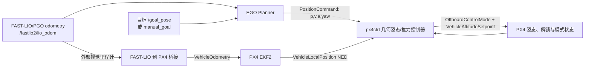
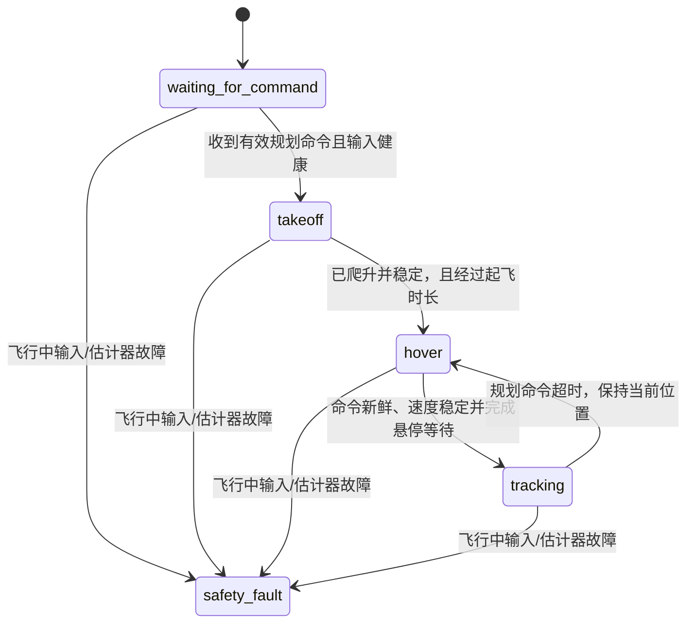

# px4ctrl 算法流程、使用与调参说明

本文对应当前 `px4ctrl_ws` 源码与 SITL 配置，主要实现见 `src/px4ctrl/src/px4ctrl_node.cpp`、`src/px4ctrl/config/px4ctrl_sitl.yaml`、`src/px4ctrl/launch/bringup.launch.py` 和 `src/fastlio2_px4_odom_bridge/`。文中给出的数值是当前仿真配置，不是实机默认值或安全认证参数。

## 1. 系统在做什么

当前控制链不是“把 EGO 轨迹送进 PX4 位置控制器”。`px4ctrl` 在 ROS 2 侧读取 EGO 的位置、速度、加速度和航向参考，结合 PX4 本地位置/速度误差，自己计算期望机体姿态和归一化推力，再发布到 PX4 的 `VehicleAttitudeSetpoint`。它绕过 PX4 的位置环和速度环；PX4 的姿态/角速度控制、控制分配和电机输出仍在工作。



FAST-LIO 在这里承担两项不同工作：给 EGO 提供规划状态；经 `fastlio2_px4_odom_bridge` 发布外部视觉里程计，供 PX4 EKF2 融合。控制器的闭环位置/速度反馈使用 PX4 `/fmu/out/vehicle_local_position_v1`。因此，桥接输出的 FAST-LIO 位置和 PX4 local position 是两路有关联但职责不同的数据，不能把两组数值不经坐标变换就直接比较。

## 2. 坐标系与对齐

EGO 和 FAST-LIO 的规划坐标约定为 `lidar` 世界系；目标点、EGO `PositionCommand` 的位置/速度/加速度以及手动目标均使用这个坐标系。PX4 本地位置使用 NED：X 北、Y 东、Z 向下。PX4 机体轴为 FRD：X 前、Y 右、Z 下。FAST-LIO 输入的机体系由传感器/IMU 配置决定，桥接参数当前假定其与机体 FLU 对齐。

当前规划世界系到 PX4 NED 的旋转矩阵为：

\[
R_{NED\leftarrow lidar}=\begin{bmatrix}0&1&0\\1&0&0\\0&0&-1\end{bmatrix},\qquad
\begin{bmatrix}x_N\\y_E\\z_D\end{bmatrix}=
R_{NED\leftarrow lidar}\begin{bmatrix}x_l\\y_l\\z_l\end{bmatrix}+t.
\]

所以当前约定下 `NED=[lidar_y, lidar_x, -lidar_z]+translation`。该矩阵是 proper rotation（行列式为 +1），不是随意交换轴的缩放。位置还要加平移 `t`；速度、加速度只乘旋转矩阵。

启动时 `align_to_px4_local_origin: true`，控制器等待 FAST-LIO 与 PX4 local position 都健康且各自速度低于 `frame_alignment_velocity_tolerance_mps=0.20`，随后计算：

\[
t=p_{PX4,local}-R_{NED\leftarrow lidar}p_{FASTLIO}.
\]

这只对齐两个局部原点，不会从数据中自动估计旋转；旋转必须与 Gazebo/IMU/FAST-LIO 的实际轴定义相符。对齐发生时应停稳，且应检查日志中的 `Aligned planner frame...`。如果开机时飞机在动、外部视觉和 PX4 EKF 尚未收敛，原点偏置会带入所有目标。不要用调 PID 的方式补偿坐标错误。

桥接发给 EKF2 的姿态也包含机体系转换。当前 `body_to_frd_row_major` 是 FLU 到 FRD 的绕 X 轴 180° 旋转 `diag(1,-1,-1)`。如果 FAST-LIO 的 IMU/body frame 并非该约定，必须按实际 TF/URDF 和静止姿态重新核对。桥接负责时间戳映射、样本时效/跳变检查、方差下限、位置原点对齐和 reset_counter；它不发轨迹或直接控制电机。EKF2 是否实际融合外部视觉，还取决于 PX4 EKF 参数与状态，需查看 PX4 日志和 local position 的有效性，不能只以 ROS topic 有消息作为融合成功的证据。

控制器也监听 PX4 EKF 的 `delta_xy`、`delta_z` 和 heading reset 计数。可接受的局部原点重置会同步修正内部目标/保持点，超过配置阈值则锁存安全故障。该处理解决 EKF 局部坐标重锚定，不等于允许 FAST-LIO 任意漂移或 PGO 大幅跳变。

## 3. 数学控制原理

计算在 PX4 NED 世界坐标中进行。定义期望状态为 EGO 轨迹服务器输出经坐标变换后的 `p_d, v_d, a_d, yaw_d`，PX4 反馈状态为 `p, v`：

\[
e_p=p_d-p,\qquad e_v=v_d-v.
\]

控制器先构造期望平动加速度：

\[
a_c=a_d+K_p\odot e_p+K_v\odot e_v+I,
\]

其中 `Kp/Kv/Ki` 是按 NED 三轴配置的对角增益。`a_d` 是轨迹前馈；位置比例项拉回轨迹；速度反馈提供阻尼；积分项用于小的稳态偏差。积分仅在 tracking、命令新鲜、速度误差范数足够小、上一周期输出未饱和时累加，并按每轴 `integral_limit_mps2` 限幅；其他时刻积分按 `0.995` 衰减。这是为减少大误差/饱和时的积分累积。

加速度随后受 `max_acceleration_mps2` 限制，并投影到推力和最大倾角可以实现的范围。NED 中重力为 `g_NED=[0,0,g]`，所需比力为：

\[
f=a_c-g_{NED}.
\]

机体 Z 轴设为与 `-f` 同向，再结合 yaw 构造完整旋转矩阵和四元数。PX4 的机体推力向量沿 body `-Z`，消息中发送 `thrust_body=[0,0,-T]`。当前推力映射近似使用悬停标定值：

\[
T=hover\_thrust\frac{g-a_z}{g\,b_{3,z}},
\]

其中 `b3` 是限倾后的机体 Z 轴在 NED 中的方向；结果再限幅到 `[min_thrust,max_thrust]`。实现会先把不可达的加速度投影进推力/倾角包络，并标记 saturation；积分器随后衰减。若持续饱和，轨迹仍可能跟不上，不能通过无限增大 `Kp` 解决。

偏航方面，EGO `traj_server` 默认向前看约 1 秒，根据未来轨迹方向生成 yaw，并限制自身 yaw 变化率；控制器把规划系航向向量转换至 NED。收到 `manual_yaw_topic` 时，该角度覆盖 EGO yaw，但仍受控制器的最大偏航速度和偏航加速度约束。因此手动要求转 180° 会花时间完成，yaw 角单位在 ROS 目标 CLI 中是度、控制内部/话题中是弧度。

## 4. 状态机、起飞与失效行为



当前 SITL 首个有效命令触发自动 Offboard/解锁流程。姿态设定值以 100 Hz 发送；先预流 `1 s`，再请求 Offboard，PX4 状态满足条件后请求解锁。起飞保持点取当时 PX4 local position，NED Z 减 `0.50 m` 表示向上爬升。达到目标高度容差或至少爬升 `0.25 m`，且速度低于阈值并经过 `3 s`，进入 hover。稳定 `0.80 s` 后，才切到 tracking；交接参考从当前测量状态平滑过渡 `0.75 s`。EGO 重规划的参考跳变还会在 planner frame 内做 `0.25 s` 平滑。

若命令超过 `command_timeout_sec=0.50` 未更新，控制器转为保持当前 PX4 local position；这不是继续追旧轨迹。原点对齐前，控制器还要求 FAST-LIO odometry 新鲜；对齐后，闭环健康门控主要使用 PX4 local position 的时效和有效性。FAST-LIO 停流会导致 EGO 参考停止更新、命令超时后悬停，桥接也会停止送入新 EV 样本；这与 PX4 local position 本身失效是不同故障。PX4 local position 不健康且故障持续超过 `local_position_fault_delay_sec=1 s` 时会锁存安全故障；`land_on_safety_fault=true` 时请求 PX4 LAND，并停止发布正常姿态 setpoint。EGO emergency stop 在 PX4 local position 健康时会变为当前位置保持；若没有健康位置，则进入安全故障。不要把 emergency hold 和 LAND 混为同一种行为。

控制器对轨迹参考施加 `minimum_tracking_altitude_m=0.25 m` 的最低高度保护（相对启动起飞原点）；小于安全高度的下行参考会被夹住。它不能替代避障、地形高度估计或独立硬件失控保护。

## 5. 构建与启动

先按项目现有流程在独立终端启动 PX4/Gazebo（SITL）以及 FAST-LIO/PGO。`bringup.launch.py` 不启动 PX4、Gazebo 或 FAST-LIO/PGO；它启动 EGO、轨迹服务器、桥接、控制器和默认的 MicroXRCEAgent。

```bash
source /opt/ros/jazzy/setup.bash
source ~/GRA_1/ws_livox/install/setup.bash
cd ~/GRA_1/px4ctrl_ws
colcon build --symlink-install --executor sequential
source install/setup.bash
ros2 launch px4ctrl bringup.launch.py start_rviz:=false
```

若 MicroXRCEAgent 已由其他 launch 启动，避免重复占用 UDP 8888：

```bash
ros2 launch px4ctrl bringup.launch.py start_agent:=false
```

确认 `/fastlio2/lio_odom`、PX4 local position 和控制器状态正常后发送目标。目标以 `lidar` 规划世界系的米为单位：

```bash
ros2 run px4ctrl manual_goal 4.0 -4.0 0.5 90 --wait-timeout 30
```

最后的 `90` 是目标 yaw（度）。使用自动航向时：

```bash
ros2 run px4ctrl manual_goal 4.0 -4.0 0.5 --auto-yaw --wait-timeout 30
```

CLI 会检查 odom frame/新鲜度、PX4 local position validity、估计器 reset 稳定性、低速状态以及 PX4 armed/offboard 状态。第一次命令可能先用于触发控制器起飞与悬停状态，达到 ready 后再发布目标。`manual_goal` 是面向 EGO 的目标发送器，不是直接给 PX4 设 `trajectory_setpoint`。

常用诊断：

```bash
ros2 topic echo /px4ctrl/status
ros2 topic echo /fastlio2/lio_odom --once
ros2 topic echo /drone_0_planning/pos_cmd --once
ros2 topic echo /fmu/out/vehicle_local_position_v1 --once
ros2 topic echo /fmu/out/vehicle_status_v4 --once
ros2 topic info -v /fmu/in/vehicle_attitude_setpoint_v1
ros2 topic echo /fmu/in/vehicle_attitude_setpoint_v1 --once
```

排查顺序：先看 frame_id/坐标轴和消息新鲜度，再看控制器状态与 PX4 local position validity/reset，再看设定值是否到达 PX4，最后才看跟踪误差、推力/倾角饱和和增益。若控制器有 `state_tracking_attitude_thrust_tracking` 但飞机偏差大，先对比 `pos_cmd` 经矩阵变换后的 NED 目标和 PX4 local position；不要只比较 lidar 目标与 NED 输出的数值。

## 6. 参数怎么分层调整

参数文件为 `src/px4ctrl/config/px4ctrl_sitl.yaml`。控制器源码有默认值，但 bringup 默认显式加载此 YAML；实际生效值以启动参数文件为准。建议复制成自己的参数文件后通过 `px4ctrl_params:=/path/to/file.yaml` 加载，保留原始 SITL 基线。

| 参数组 | 当前值 | 调整目的与注意事项 |
|---|---:|---|
| `planner_frame`, `transform_rotation_row_major` | `lidar`；上述 R | 坐标定义。必须依据 TF、IMU 与 NED 轴方向确定；不能用于“调到看起来能飞”。矩阵须为合法旋转。 |
| `align_to_px4_local_origin`, `frame_alignment_velocity_tolerance_mps` | `true`, `0.20 m/s` | 初始平移对齐和对齐时停稳门限。开机起飞前需等 FAST-LIO 与 PX4 静止、有效；只有两坐标原点本就相同且经过验证时才考虑关闭。 |
| `hover_thrust` | `0.864` | 当前 X500 + 云台 + MID-360 SITL 的悬停输出标定值。偏低会持续下沉，偏高会爬升/饱和。先做安全悬停测量；机体、电池、载荷、固件变化都可能要求重标定。 |
| `min_thrust`, `max_thrust`, `max_tilt_deg`, `max_acceleration_mps2` | `0.08`, `0.95`, `30°`, `4.0 m/s²` | 执行器/姿态/轨迹加速度包络。越保守越难追快速轨迹；设得过大则请求不可达并加重饱和。结合实际最大推力、PX4姿态能力和规划器动态限制调整。 |
| `kp`, `kv` | `[1.5,1.5,1.8]`, `[1.2,1.2,1.4]` | 位置拉回强度与速度阻尼，单位分别约为 `s^-2` 和 `s^-1`。先单轴小幅调整 Kp，再用 Kv 抑制超调/振荡；XY、Z 动力学不同，可分别调。增益过大易振荡、倾角/推力饱和。 |
| `ki`, `integral_limit_mps2`, `integral_enable_velocity_error_mps` | `[.10,.10,.15]`, `[.4,.4,.5]`, `.60` | 小偏差下消除稳态误差。只在坐标/hover thrust/Kp/Kv 已合理后微调；若积分长期顶限、饱和或出现慢摆，减小 Ki/积分限幅或检查偏置来源。 |
| `max_yaw_rate_radps`, `max_yaw_acceleration_radps2` | `.6`, `.8` | 限制转身速度与偏航加速度。转向太慢可小幅提高，但大姿态变化期间要观察水平跟踪、推力余量和 PX4 姿态响应。 |
| `command_timeout_sec`, `state_timeout_sec`, `local_position_timeout_sec` | `.50`, `.30`, `.50 s` | 输入失效判定。应略大于实际消息间隔且保持故障响应及时；不要因偶发 timeout 就大幅放宽，先查 ROS/Gazebo 时钟、CPU 调度、QoS 和数据实际频率。 |
| `prestream_seconds`, `publish_rate_hz`, `start_offboard_on_first_command`, `arm_on_first_command` | `1 s`, `100 Hz`, `true`, `true` | Offboard 预流、发送频率和自动模式/解锁。调整需符合所用 PX4 版本的 Offboard 要求及实验安全流程。 |
| `auto_takeoff_altitude_m`, `minimum_takeoff_altitude_m`, `takeoff_duration_sec`, `takeoff_tolerance_m` | `.50 m`, `.25 m`, `3 s`, `.08 m` | 自动起飞与释放门限。改变前先确认地面坐标、悬停推力和高度方向；较长 duration 是最短等待，不保证一定到达目标高度。 |
| `hover_settle_sec`, `hover_velocity_tolerance_mps`, `tracking_handoff_sec`, `command_blend_sec` | `.80 s`, `.15 m/s`, `.75 s`, `.25 s` | 起飞后稳定时间和轨迹交接平滑度。过短会在仍运动时接管；过长则响应慢。重规划突变明显时可适当加 blend，但不可掩盖规划器输出跳变。 |
| `max_command_position_jump_m`, `max_command_velocity_jump_mps` | `.35 m`, `1.5 m/s` | 两次 EGO 命令之间的位置/速度跳变超过门限时触发平滑过渡，不是丢弃命令。需结合 EGO 重规划更新率与正常动态来设；过大跳变仍可能让飞机追赶不可行的参考。 |
| `minimum_tracking_altitude_m` | `.25 m` | 相对启动原点的最低跟踪高度保护。按场景净空、安全需求调整；不能将其当作避障地图或可靠离地高度测量。 |
| `max_ekf_reset_delta_m`, `max_ekf_reset_heading_rad`, `land_on_safety_fault` | `3 m`, `3.2 rad`, `true` | EKF reset 容忍度与安全落地策略。只有理解 PX4 reset 语义、观测真实 reset 分布后才调整；随意放大可能吞掉定位故障。 |
| `use_sim_time` | `true` | SITL 与 Gazebo `/clock` 同步。实机参数文件必须设为 `false`，并验证系统时间、PX4 时间戳桥接和所有 ROS 节点时钟一致。 |

建议的调参次序：

1. 固定并验证静止坐标变换、lidar→NED 目标映射、FAST-LIO body frame→FRD 姿态；记录自动原点对齐结果。
2. 确认 PX4 EKF 确实融合外部视觉，local position 的 `xy_valid/z_valid/v*_valid` 正常、reset 不持续增长，位置和速度方向正确。
3. 在可控 SITL 中单独标定悬停推力，观察稳定悬停时 thrust/高度变化；再确认未持续受 max thrust、tilt 或 acceleration 限制。
4. 用短距离、低速度、固定 yaw 轨迹调整 Kp/Kv；先压低振荡和超调，再改善响应速度。然后检查直线、停点和往返。
5. 之后才逐步启用/调整 Ki、auto-yaw 与转身轨迹，观察饱和、状态机和安全降级行为。
6. 最后才调整超时、reset 阈值和起飞/交接时间，门限需由采样频率和日志证据支撑。

## 7. 时间、SITL 与实机差异

SITL YAML 使用 `use_sim_time: true`，控制器定时器和 EGO 轨迹采样跟随 ROS `/clock`；Gazebo 暂停或因 GUI/计算负载变慢时，这些节点的仿真时间也暂停/变慢。PX4 uORB 时间戳由 PX4 消息提供；FAST-LIO 桥接会根据 ROS 与 PX4 时钟样本建立映射并维护 `timestamp_sample`。因此定位样本、定时器和 PX4 时间戳必须一起检查，不能把墙钟下的等待时间直接等同仿真时间。

实机需使用独立参数文件并设 `use_sim_time: false`，核对真实传感器安装外参、FLU/FRD 与 NED/ENU 转换、PX4 EKF2 外部视觉配置、Micro XRCE-DDS 链路、推力映射、电池电压和控制频率。直接姿态/推力控制跳过 PX4 的位置环/速度环，错误的推力标定或坐标变换会直接影响飞行。应在拆桨/台架、系留或受控环境逐级验证，并保留 PX4 原生 failsafe；当前 SITL 成功不能作为实机可飞的证明。

## 8. 当前测试结果的适用范围

本工作区 `performance/results/2026-11-06_REPORT.md` 记录了当前 SITL 四段目标测试：`(4,-4,0.5)`、`(0,0,0.5)`、`(4,0,0.5)`、`(0,0,0.5)`。报告统计终点误差、轨迹 RMSE/P95/最大误差、姿态偏差与末段悬停速度；该组测试结果可作为当前代码的仿真基线。它不覆盖实机、所有障碍环境、风扰、传感器故障或所有 PX4 固件/参数组合。性能数字与原始 CSV 应以该报告及同目录数据为准。

### 8.1 “全程指标”逐项解释

报告的统计区间是整段 108.2 秒试验；悬停位置和速度指标则只取最后 5 秒。除特别注明外，位置误差在 `lidar` 规划坐标系计算，速度为 FAST-LIO 提供的机体速度模长。

| 报告指标 | 计算方法 | 怎么理解本次结果 |
|---|---|---|
| 采样数 / 总时长 | 记录器写入的有效数据行数 / 首末采样时间差 | 2090 个样本覆盖 108.2 秒。样本多只说明记录长度，不代表控制回路同样高频。 |
| 采样频率中位数 | 相邻记录时间差的中位数取倒数，`1 / median(dt)` | 19.72 Hz 表示典型记录频率约每秒 20 次；它是性能记录器频率，不是 `px4ctrl` 配置的 100 Hz 控制循环频率。 |
| 采样间隔 P95 | 所有相邻记录间隔的第 95 百分位 | 55.6 ms 表示约 95% 的记录间隔不超过 55.6 ms，剩余约 5% 更长。它反映记录节奏尾部延迟，不直接等于飞控控制延迟。 |
| 命令到 FAST-LIO 路径误差 RMSE | 每个样本计算 `||pos_cmd - pos_FASTLIO||₂`，再对误差平方求均值、开方 | 0.177 m 是整个过程中“当前规划参考”与 FAST-LIO 估计位置差的总体均方根。它衡量命令跟踪残差，FAST-LIO 本身不是外部真值，因此不等于真实定位误差。 |
| 路径误差 P95 / 最大值 | 对上述每时刻 3D 距离误差取第 95 百分位 / 最大值 | 0.329 / 0.491 m。P95 代表绝大多数样本的误差范围；最大值会被短暂峰值主导。 |
| 水平 / 垂直误差 RMSE | 水平为 `sqrt(mean(dx²+dy²))`；垂直为 `sqrt(mean(dz²))` | 0.156 / 0.084 m。可用来判断误差主要来自 XY 平面还是高度方向。这里的“垂直”仍是 lidar 坐标的 Z 轴误差绝对值。 |
| FAST-LIO 速度峰值 | 每个样本对 FAST-LIO 机体系线速度三分量求模，再取最大值 | 0.879 m/s 是本次测试中的最大估计速度，用来描述任务运动强度，不代表控制器的速度上限。 |
| 最后 5 s 悬停位置标准差 X/Y/Z | 各轴 FAST-LIO 位置在最后 5 秒的总体标准差（总体方差定义，除以样本数 N） | 0.034 / 0.015 / 0.001 m，分别表示约 3.4 cm、1.5 cm、1 mm 的轴向离散程度。小标准差代表末段位置比较稳定，但不会揭示绝对位置偏差。 |
| 最后 5 s 悬停速度 RMS / 峰值 | 先逐样本计算速度模长；RMS 为模长平方均值开方，峰值为最大模长 | 0.045 / 0.057 m/s 表示末段仍有少量运动，RMS 是典型整体运动水平，峰值是观察窗口内最大瞬时值。 |
| 姿态指令跟踪角误差均值 / P95 / 最大值 | PX4 实际姿态四元数与姿态设定四元数的最短旋转角距离，再统计均值、P95 和最大值 | 1.05° / 4.44° / 9.14°。这是 PX4 姿态内环跟踪外部姿态设定的误差，不是位置误差，也不直接表示倾角大小。 |
| 推力饱和代理 | 统计 `abs(thrust_z) >= 0.949` 的样本比例；0.949 是配置最大推力 0.95 附近的阈值 | 本次 0.00%，峰值 0.943，说明采样数据里没有触及该代理阈值。它是根据 ROS 姿态设定推力推断的“接近上限”指标，并非电机输出/电流意义上的实际饱和检测。 |
| PX4 failsafe / Offboard lost 样本 | 统计记录中 PX4 failsafe 或 Offboard 丢失标志为真的样本数 | 0 表示本次记录没有捕获到这两类状态。它不能证明所有故障场景都安全。 |
| Planner emergency 计数最大值 | 读取 `/planning/emergency_stop` 事件累计计数并取试验最大值 | 0 表示本次没有记录到规划器 emergency stop。它不是碰撞检测次数或障碍数量。 |
| EKF reset 计数变化 XY / Z / heading | 分别用记录到的 reset counter 最大值减最小值 | `0 / 0 / 0` 表示本次 XY、Z 和航向局部坐标重置计数未变化；不是估计误差为零。 |

航点表里的指标也常见：`到点时间` 从发送该目标到持续满足到达条件计时；本次判据为位置误差 `<=0.25 m`、速度 `<=0.20 m/s` 并连续保持 2 秒。`到点误差` 是到达时 FAST-LIO 位置与目标点的 3D 距离，`到点速度` 是当时速度模长。`超调` 是沿起点到目标点方向，轨迹超过目标平面的最大距离；0.000 m 表示没有测到沿该方向越过目标的现象，不代表所有方向都没有摆动。

### 8.2 缩写与英文术语

| 缩写/术语 | 英文全称 | 在本项目中的意思 |
|---|---|---|
| PX4 | PX4 Autopilot | 飞控软件。这里运行姿态/角速度内环、控制分配、电机输出和飞行状态机；位置/速度外环由 `px4ctrl` 绕过。 |
| ROS / ROS 2 | Robot Operating System / Robot Operating System 2 | 机器人软件通信框架；本项目节点、topic、launch 和参数运行在 ROS 2 上。 |
| EGO-Planner | EGO-Planner: An ESDF-free Gradient-based Local Planner for Quadrotors | 本项目使用的局部轨迹规划器。EGO 是项目名称；不要按字面把它解释成无人机的状态或一种通用控制算法。 |
| ESDF | Euclidean Signed Distance Field | 欧氏有符号距离场，记录空间点到障碍边界的带符号距离。EGO-Planner 的名称强调其规划方法不依赖构建完整 ESDF。 |
| FAST-LIO | Fast LiDAR-Inertial Odometry | 激光雷达与惯性测量融合的里程计/建图算法，为规划和 PX4 外部视觉输入提供状态。 |
| PGO | Pose Graph Optimization | 位姿图优化；通过回环等约束修正累计漂移，可能让全局位姿发生跳变或修正。 |
| EKF / EKF2 | (Error-State) Extended Kalman Filter / PX4 EKF2 | 扩展卡尔曼滤波器；PX4 EKF2 融合 IMU、外部视觉等传感器，估计本地位置、速度、姿态。 |
| EV | External Vision | 外部视觉/外部里程计输入类别。此项目桥接把 FAST-LIO 的 `VehicleOdometry` 送给 PX4，是否融合由 EKF2 配置和运行状态决定。 |
| SITL | Software-In-The-Loop | 软件在环仿真；PX4 固件与 Gazebo 仿真环境联调，不是实机飞行。 |
| NED | North-East-Down | 北-东-地坐标系，PX4 常用本地导航坐标；Z 正方向向下。 |
| ENU | East-North-Up | 东-北-天坐标系，ROS 中常见世界坐标约定之一；不能与 NED 不经变换混用。 |
| FRD | Forward-Right-Down | 前-右-下机体系，PX4 常用机体坐标约定。 |
| FLU | Forward-Left-Up | 前-左-上机体系，ROS 机器人机体坐标常见约定。FLU 转 FRD 会翻转 Y、Z 轴。 |
| IMU | Inertial Measurement Unit | 惯性测量单元，提供角速度和比力/加速度测量。安装轴向和外参会影响姿态及坐标变换。 |
| uORB | PX4 Object Request Broker | PX4 内部消息总线。`/fmu/in`、`/fmu/out` 是经 ROS 2/DDS 暴露出来的 PX4 消息接口，不是 ROS 节点内部直接访问 uORB。 |
| DDS | Data Distribution Service | ROS 2 底层分布式通信中间件；PX4 与 ROS 2 之间通过 Micro XRCE-DDS 客户端/代理桥接。 |
| CLI | Command-Line Interface | 命令行接口；`ros2 run px4ctrl manual_goal ...` 是目标发送 CLI。 |
| QoS | Quality of Service | ROS 2 消息服务质量配置，包含可靠性、队列深度等；发布/订阅 QoS 不兼容时 topic 看似存在但消息可能收不到。 |
| PID | Proportional-Integral-Derivative | 比例-积分-微分控制器。文档中的位置加速度环是 P/速度反馈/受限积分结构，并非完整经典 PID（没有单独的位置误差微分项；速度误差承担阻尼作用）。 |
| RMSE | Root Mean Square Error | 均方根误差，`sqrt(mean(error²))`；对大误差更敏感，表示总体误差量级。 |
| RMS | Root Mean Square | 均方根。报告里用于速度模长，表示一段时间内的典型运动强度。 |
| P95 | 95th Percentile | 第 95 百分位；约 95% 的样本不超过这个值，剩余约 5% 更大。它不是“95% 置信区间”。 |
| Hz | Hertz | 赫兹，每秒次数。100 Hz 表示名义上每秒发布/更新 100 次。 |
| ms | millisecond | 毫秒，1 ms = 0.001 秒。 |
| deg | degree | 度；yaw CLI 输入和性能报告姿态角使用度。控制参数 `*_rad*` 使用弧度制。 |
| XY / Z | Horizontal axes / vertical axis | XY 表示水平两个轴，Z 表示垂直轴；具体正方向取决于坐标系。NED 的 Z 向下，lidar 系的 Z 需依据当前场景定义。 |

文中其他常见控制符号：`p` 是位置，`v` 是速度，`a` 是加速度，右下标 `d` 表示期望值；`e_p/e_v` 分别是位置/速度误差；`Kp`、`Kv`、`Ki` 分别是位置比例、速度反馈和积分增益；`I` 是积分产生的加速度修正；`g` 是重力加速度；`T` 是归一化推力；`b3` 是机体 Z 轴在世界系中的单位向量；`RMS/RMSE` 的 `mean` 都是对记录样本求平均。

## 9. 相关文件

- 控制链简图与接口：`CONTROL_CHAIN.md`
- 上游设计/调参研究：`PX4CTRL_RESEARCH.md`
- 当前工作区快速启动：`README.md`
- 性能测试和数据：`performance/README.md`、`performance/results/2026-11-06_REPORT.md`；测试工具：`src/px4ctrl/test/performance/`
- 控制器实现：`src/px4ctrl/src/px4ctrl_node.cpp`
- SITL 控制器参数：`src/px4ctrl/config/px4ctrl_sitl.yaml`
- 启动编排：`src/px4ctrl/launch/bringup.launch.py`
- FAST-LIO 到 PX4 桥接及其参数：`src/fastlio2_px4_odom_bridge/`
